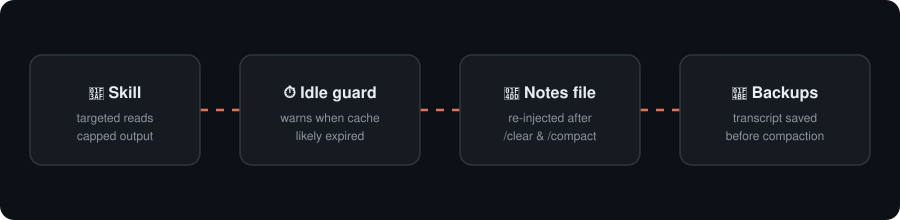

<div align="center">


[](LICENSE)


### A Claude Code plugin that lowers your bill by cutting **cache read** and **cache write** tokens,<br/>with guardrails so important context is never lost.

</div>

---



> [!NOTE]
> Every turn, Claude Code resends your whole conversation. Most of it comes from the prompt cache, but you still pay for it on every turn (**cache read, 0.1x** input price), and anything new or expired is billed as a **cache write (1.25x**, or 2x with the 1-hour cache).
>
> So cost scales with **how big your context is** and **how often the cache is rebuilt**. cctoken-saverr attacks both, without trading away correctness.

<br/>

## 🧭 Contents

<table>
<tr>
<td width="33%" valign="top">

**🚀 Get started**
- [✨ Features](#features)
- [📦 Install](#install)
- [✅ Check it's working](#check-its-working)
- [🕹️ How to use it](#how-to-use-it)

</td>
<td width="33%" valign="top">

**🧠 Concepts**
- [🛡️ Guardrails](#guardrails)
- [⏱️ The 5-minute idle problem](#idle-problem)
- [⚙️ Configuration](#configuration)
- [🏢 Teams & companies](#teams)

</td>
<td width="33%" valign="top">

**🔧 Maintenance**
- [🔄 Updating](#updating)
- [🧹 Disable or uninstall](#uninstall)
- [🩺 Troubleshooting](#troubleshooting)
- [⚠️ Limitations](#limitations)

</td>
</tr>
</table>

<br/>

<a id="features"></a>
## ✨ Features

<table>
<tr>
<td width="50%" valign="top">

### 🎯 1. The skill
Teaches Claude Code habits that keep the context small.

- 🔍 **Targeted reading** — grep/rg/glob first, then only the needed line ranges. No re-reading unchanged files.
- 🗑️ **Skips junk** — lockfiles, `node_modules`, `dist/`, minified bundles, large fixtures.
- ✂️ **Capped output** — `head`/`tail`/`grep`, quiet flags (`pytest -q`, `git diff --stat`).
- 🤖 **Subagents for exploration** — only a short summary returns.
- 🪶 **Lean edits and replies** — targeted replacements, paths instead of pasted code.
- 🧊 **Cache stability** — avoids mid-session model switches and MCP toggles.
- 🧼 **Session hygiene** — suggests `/clear`, `/compact`, `/context`, `/usage` at the right time.

</td>
<td width="50%" valign="top">

### ⏱️ 2. Idle guard
Warns you when you return after the cache has likely expired, and tells you how many tokens are about to be rewritten. Once per break, only for contexts big enough to matter. Optional `block` mode.

### 🛡️ 3. Guardrails <sub>`new in 0.2.0`</sub>
- 📐 **Correctness-first rules** — read before editing, keep error output, never drop requirements.
- 📝 **Project notes file** — auto re-injected after `/clear` or `/compact`.
- 🤝 **`/cctoken-saverr:handoff`** — save the session's key context in one step.
- 💾 **Transcript backup** before every compaction.

### 🧰 4. Setup extras
`examples/settings.json` (1-hour cache + hooks) and `examples/CLAUDE.md.snippet` (5-line always-on rules).

</td>
</tr>
</table>

<a id="install"></a>
## 📦 Install

> [!IMPORTANT]
> Requires Claude Code with plugin support and **Python 3** (for the hooks). No other dependencies.

**① From GitHub** <sub>(recommended)</sub> — inside Claude Code:
```
/plugin marketplace add V-inaya-K/cctoken-saverr
/plugin install cctoken-saverr@cctoken-saverr
```
The first `cctoken-saverr` is the plugin, the second is the marketplace. You can also type `/plugin` and pick it from the menu. Then **restart Claude Code** so the hooks load.

<details open>
<summary><b>🖥️ Claude desktop app</b> (Code tab)</summary>

The desktop app's Code tab and the CLI share the same `~/.claude` config, so a plugin installed from a terminal shows up in the app too.

1. Open any terminal (PowerShell, Terminal, or the app's built-in terminal panel) and run:
   ```bash
   claude plugin marketplace add V-inaya-K/cctoken-saverr
   claude plugin install cctoken-saverr@cctoken-saverr
   ```
   No `claude` command? Install the CLI first: `npm install -g @anthropic-ai/claude-code`.
2. **Fully quit and reopen** the Claude desktop app so the hooks load.
3. Start a new session in the Code tab and type `/` — you should see **/cctoken-saverr:handoff**.

> [!TIP]
> On Windows, if hooks don't fire, make sure `python` (or `python3`) runs from PowerShell. See [Troubleshooting](#troubleshooting).
</details>

<details>
<summary><b>② From a local folder</b> (for testing before you publish)</summary>

```
/plugin marketplace add ./path/to/cctoken-saverr
/plugin install cctoken-saverr@cctoken-saverr
```
</details>

<details>
<summary><b>③ Manually</b> (without the plugin system)</summary>

```bash
git clone https://github.com/V-inaya-K/cctoken-saverr
mkdir -p ~/.claude/skills ~/.claude/commands ~/.claude/cctoken-saverr
cp -r cctoken-saverr/skills/cctoken-saverr ~/.claude/skills/
cp cctoken-saverr/commands/handoff.md ~/.claude/commands/
cp cctoken-saverr/hooks/idle_guard.py ~/.claude/cctoken-saverr/
```
Then merge the `hooks` block from `examples/settings.json` into `~/.claude/settings.json`. With a manual install the command is `/handoff` instead of `/cctoken-saverr:handoff`.
</details>

<a id="check-its-working"></a>
## ✅ Check it's working

- [x] `/plugin` lists **cctoken-saverr** as installed and enabled.
- [x] `/hooks` shows **Stop**, **UserPromptSubmit**, **PreCompact** and **SessionStart** hooks pointing to `idle_guard.py`.
- [x] Ask Claude *"what skills do you have?"* and it mentions **cctoken-saverr**.
- [x] Type `/` and you see **/cctoken-saverr:handoff**.

<a id="how-to-use-it"></a>
## 🕹️ How to use it

Mostly it works in the background:

| When | What happens / what to do |
|---|---|
| 🔍 Claude explores code, reads files, runs commands | **The skill** kicks in. To force it: *"use the cctoken-saverr skill"*. |
| ☕ You return after a break with a large context | **The idle warning** appears. Starting something new → `/cctoken-saverr:handoff` then `/clear`. Still need the context → `/compact keep <what matters>`. Or just continue. |
| 🔀 Switching tasks | `/cctoken-saverr:handoff`, then `/clear`. The new session starts small and still knows your decisions. |
| 📊 Checking savings | `/usage` or `/cost` before and after. |

<a id="guardrails"></a>
## 🛡️ Guardrails: protecting important context

> [!TIP]
> Saving tokens is never worth losing the thread. cctoken-saverr protects context at three levels.

| ⚠️ Risk | 🛡️ Guardrail |
|---|---|
| Claude trims too aggressively and misses something | Correctness-first rules in the skill always win over saving tokens |
| `/clear` wipes decisions and requirements | Notes file + `/cctoken-saverr:handoff`, re-injected automatically after `/clear` |
| `/compact` summary drops a detail | Notes file re-injected after compaction; use `/compact keep ...` with a focus |
| Something is lost anyway | Full transcript backup before every compaction in `~/.claude/cctoken-saverr/backups/` |

**📝 About the notes file:** it lives at `.claude/cctoken-saverr-notes.md` in your project. Keep it short (under ~40 lines); injected notes are capped at 4,000 characters because they're resent every turn. Commit it if your team should share it, or add it to `.gitignore` if it's personal.

**💾 Recovering from a backup:** backups are the raw session transcript (JSONL). Open one and search for what you need, or ask Claude: *"find the part about X in ~/.claude/cctoken-saverr/backups/&lt;file&gt;"* (it will grep it, not read the whole thing). The last 20 backups are kept.

<a id="idle-problem"></a>
## ⏱️ The 5-minute idle problem

The prompt cache expires after **5 minutes** without activity. Take a 10-minute break in a 150k-token session and your next message rewrites all 150k tokens at the write price instead of reading them, roughly **12x more** for that turn.


The idle guard warns you:
```
cctoken-saverr: idle 12 min (cache TTL ~5 min). ~142k tokens of context will be re-written to the cache.
To keep important context, run /cctoken-saverr:handoff first, then /clear (cheapest) or /compact (keeps a summary).
```

> [!TIP]
> **1-hour cache:** if you use an API key or a cloud provider (Bedrock, Vertex, Foundry), add this to `~/.claude/settings.json` (Claude Code v2.1.242+):
> ```json
> {
>   "promptCacheTtl": "1h",
>   "env": { "CCTOKEN_SAVERR_TTL_MINUTES": "60" }
> }
> ```
> One-hour writes cost 2x instead of 1.25x, so this pays off if you often pause 5–60 minutes, not for short sessions. See the [official prompt caching docs](https://code.claude.com/docs/en/prompt-caching).

<a id="configuration"></a>
## ⚙️ Configuration

Set these in the `env` block of `settings.json`. All are optional.

| Variable | Default | Meaning |
|---|---|---|
| `CCTOKEN_SAVERR_TTL_MINUTES` | `5` | Cache lifetime to assume. Use `60` with `promptCacheTtl: "1h"`. |
| `CCTOKEN_SAVERR_MIN_TOKENS` | `20000` | Don't warn for smaller contexts. |
| `CCTOKEN_SAVERR_MODE` | `warn` | `warn`, `block` (stops the first prompt after a break; resend to continue; the blocked prompt isn't kept, so copy long ones) or `off`. |
| `CCTOKEN_SAVERR_BACKUP` | `1` | Back up the transcript before compaction. `0` disables. |
| `CCTOKEN_SAVERR_BACKUP_KEEP` | `20` | Number of backups to keep. |
| `CCTOKEN_SAVERR_NOTES_FILE` | `.claude/cctoken-saverr-notes.md` | Notes path, relative to the project. |
| `CCTOKEN_SAVERR_NOTES_ON` | `clear,compact` | When to inject notes: any of `startup,resume,clear,compact`, or `none`. |
| `CCTOKEN_SAVERR_NOTES_MAX_CHARS` | `4000` | Cap on injected notes. |

> [!NOTE]
> **Why a skill *and* a CLAUDE.md snippet?** Skills load only when Claude thinks they're relevant. `examples/CLAUDE.md.snippet` is a 5-line always-on version. Keep it short; CLAUDE.md is resent every turn too.

<a id="teams"></a>
## 🏢 Using it in a company or team

**👤 Individuals** install it from GitHub as above and compare `/usage` before and after.

**👥 A team, for one repo:** commit this to the project's `.claude/settings.json`. Everyone who opens the repo is prompted to install it:
```json
{
  "extraKnownMarketplaces": {
    "cctoken-saverr": {
      "source": { "source": "github", "repo": "V-inaya-K/cctoken-saverr" }
    }
  },
  "enabledPlugins": { "cctoken-saverr@cctoken-saverr": true },
  "promptCacheTtl": "1h"
}
```
Also add `examples/CLAUDE.md.snippet` to the repo's `CLAUDE.md`, and decide whether the notes file is committed (shared) or gitignored (personal).

**🏛️ Company-wide:** admins put the same settings into Claude Code's managed settings and push them through device management. Managed settings override user settings.

> [!WARNING]
> **Before rolling out:** hooks run code on employees' machines, so fork the repo into your org, review `hooks/idle_guard.py` (~170 lines), pin a tagged release, tune the env variables, and measure spend for a pilot team in the Anthropic Console or your cloud billing. Plugin settings keys can change between Claude Code versions; check the current docs.

<a id="updating"></a>
## 🔄 Updating

```
/plugin marketplace update cctoken-saverr
```
Then update the plugin from the `/plugin` menu (or uninstall and reinstall) and restart Claude Code.

<a id="uninstall"></a>
## 🧹 Disable or uninstall

<details>
<summary><b>⏸️ Turn it off temporarily</b> (stays installed)</summary>

```
/plugin disable cctoken-saverr@cctoken-saverr
/plugin enable cctoken-saverr@cctoken-saverr
```
Or toggle it in the `/plugin` menu. Restart Claude Code afterwards.
</details>

<details>
<summary><b>🗑️ Uninstall</b> (and remove the marketplace)</summary>

```
/plugin uninstall cctoken-saverr@cctoken-saverr
/plugin marketplace remove cctoken-saverr
```
</details>

<details>
<summary><b>🎛️ Turn off only part of it</b></summary>

- Idle warning off: `"CCTOKEN_SAVERR_MODE": "off"`
- Transcript backups off: `"CCTOKEN_SAVERR_BACKUP": "0"`
- Notes injection off: `"CCTOKEN_SAVERR_NOTES_ON": "none"`
- Back to the 5-minute cache: remove `"promptCacheTtl": "1h"` from `settings.json`. That setting lives outside the plugin, so disabling the plugin doesn't undo it.
</details>

<details>
<summary><b>🧽 Clean up leftovers</b></summary>

State files and transcript backups:
```bash
rm -rf ~/.claude/cctoken-saverr
```
Your project's `.claude/cctoken-saverr-notes.md` is yours; delete it if you no longer want it.

**Manual install:**
```bash
rm -rf ~/.claude/skills/cctoken-saverr ~/.claude/cctoken-saverr ~/.claude/commands/handoff.md
```
Then remove the `idle_guard.py` entries from the `hooks` block in `~/.claude/settings.json`.
</details>

> [!CAUTION]
> If a team enabled it through project or managed settings, your own disable may be overridden; change it there or ask whoever manages the config.

<a id="troubleshooting"></a>
## 🩺 Troubleshooting

| Symptom | Fix |
|---|---|
| 🔇 **Hooks don't fire** | Check `python3 --version` works in your terminal. On Windows you may need `python` instead of `python3` in `hooks/hooks.json`. Restart Claude Code after installing. |
| 🚫 **Marketplace add fails** | The repo must be public, or you must be logged in to GitHub with access to it. |
| 😶 **No idle warning** | The context may be under 20k tokens. Set `"CCTOKEN_SAVERR_MIN_TOKENS": "5000"` to test. |
| 📭 **Notes not injected after /clear** | The file must be at `.claude/cctoken-saverr-notes.md` in the folder where you started Claude Code, and not empty. |
| ❓ **Command not recognized** | Plugin commands vary by Claude Code version; use the `/plugin` menu. |

<a id="limitations"></a>
## ⚠️ Limitations

- Claude Code places cache breakpoints itself. This plugin can't change caching mechanics, only how much goes into the context and when you rebuild it.
- Token counts come from the session transcript. If Claude Code changes that format, the estimate may read 0 and the idle warning is skipped.
- The notes file costs a few hundred tokens per turn once injected; that's the price of not losing context.
- Savings depend on how you work. Measure with `/usage`.

---

<div align="center">

### 🤝 Contributing

Issues and PRs welcome, especially **measured before/after numbers**.

**MIT License** · Made for people who'd rather spend tokens on code than on cache rewrites 💸

<sub>[⬆ Back to top](#)</sub>

</div>
